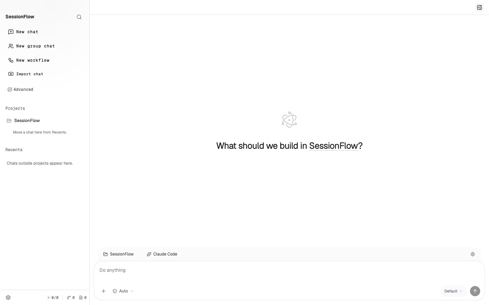
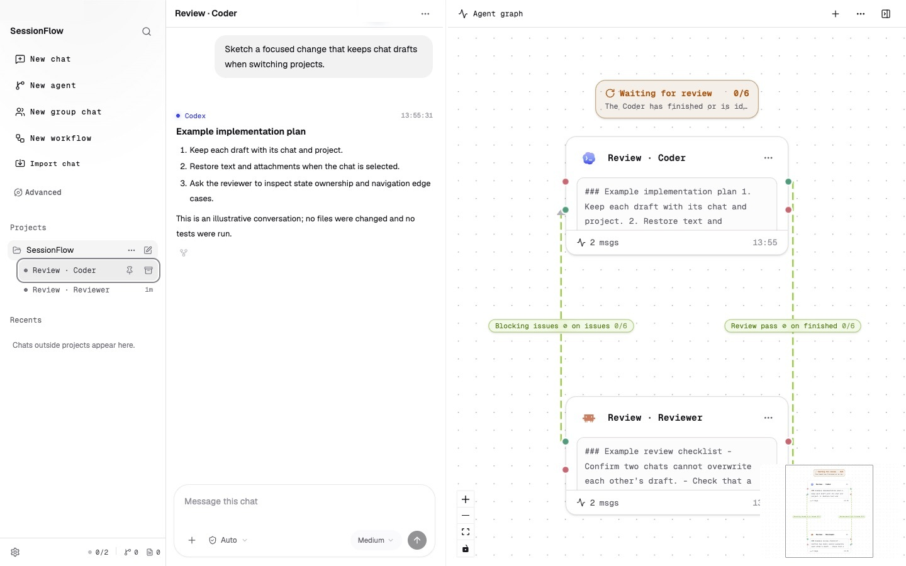
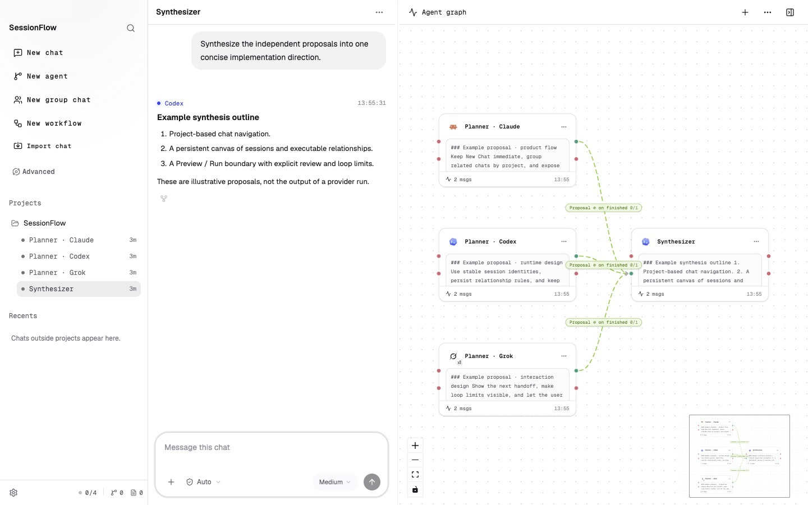

<div align="center">

# SessionFlow

**English** | [中文](./README.zh-CN.md) | [Español](./README.es.md)

### *Design the loop, not every prompt.*

**SessionFlow puts your AI coding agents on a canvas<br/>and wires them into loops that run themselves.**

[](https://github.com/zlsbksdxl/SessionFlow/releases/latest)
[](./LICENSE)
-111111?logo=apple)


[](https://github.com/zlsbksdxl/SessionFlow/releases/latest)
[](#get-started)

</div>

When you point AI at a complex programming task, you often end up running
several agents at once: different models drafting solutions and debating them,
or one agent writing code while another reviews it, round after round. But
each agent lives in its own window, and the one shuttling messages between
them is you—paste A's output to B, carry B's feedback back to A, every single
round. The more agents and the more rounds, the more you become copy-paste
middleware.

That middleware role breaks down into three jobs: moving context between
agents, triggering the right agent at the right time, and deciding when the
loop is finished. SessionFlow hands all three to the graph. Agents sit on a canvas,
connected by edges—and the edges are not a diagram, they execute: when an
upstream agent finishes, its output travels down the edge to the next agent;
the downstream conclusion flows back up and wakes the original agent to keep
going. Who triggers whom, what context moves, and when to stop are all defined
on the edge. You stop relaying messages and only set up the relationships and
the stopping condition once.

You don't assemble that graph by hand, either—**SessionFlow is not a low-code
builder.** Chat with your agents the way you always do; whenever a loop takes
shape in the conversation, the matching graph appears on the canvas
automatically, ready to edit. Power users who want to design loops directly
can do it in plain conversation too—no dragging boxes and wires.



These screenshots show the current interface; workflow graphs use illustrative session data.

A favorite pattern: throw one problem at several models at once—Codex, Claude
Code, and Grok Build each draft a solution, read and challenge each other, and
revise until the discussion converges on a consensus. Nobody carries drafts
around; the graph drives every round.

Code Review is another ready-made ring: wire a coder and a reviewer together
with one stopping condition—"until the review is clean, at most 6 laps."
Finished work goes to review automatically, blocking issues come back
automatically, and a badge on the ring shows the current lap. Any agent on the
graph is a real session you can open mid-run as a normal chat: tell the
reviewer "ignore style, logic only," and the loop keeps running.

That is what **loop-native** means—the bet this whole workspace is built on:
sessions are born into relationships, and loops are the system's mother tongue,
not a patch bolted onto isolated chats. Design the loop once; the canvas keeps
it visible, bounded, and yours to steer.

## Agents should not be islands

Most coding-agent tools treat every session as an island, with you as the ferry
between them. In SessionFlow, sessions live in relationships. They can wake one
another, exchange context, review one another, return work upstream, and
continue until a real stopping condition is met.

Two questions shape the product:

> When you step away, does the workflow keep moving?
>
> When you return, can you quickly understand what happened and why?

## Not another workflow builder

Traditional workflow tools ask you to manually assemble a pipeline before work
can begin. SessionFlow starts with an outcome.

Choose a ready-made loop or describe the goal to a Master Agent. The system can
propose the participants, relationships, permissions, and stopping conditions.
You inspect the proposal, approve it, and use the graph to understand or change
the workflow—not to draw every step from scratch.

| Traditional workflow builder           | SessionFlow                                                           |
| -------------------------------------- | --------------------------------------------------------------------- |
| Starts from an empty canvas            | Starts from a goal or ready-made loop                                 |
| Nodes are stateless actions            | Nodes are long-lived agent sessions                                   |
| Edges mainly route data forward        | Relationships carry context, reviews, evidence, retries, and triggers |
| Optimized for a DAG and its happy path | Rejection, repair, return paths, and repeated verification are native |
| The graph describes a planned pipeline | The graph remains live while agents work                              |

Unlike systems that call a model as a disposable step, every SessionFlow node
remains a real session. Open it as a normal chat, inspect its messages and tool
activity, intervene, freeze future activations, or resume it with its existing
history.

## The graph defines the loop; prompts define the work

SessionFlow does not need a built-in action for every job an agent might
perform.

Code review, testing, research, migration, triage, summarization, and security
analysis can all be expressed through prompts. The graph supplies the reusable
control semantics around them:

- what event triggers the next session;
- what context moves with the handoff;
- whether a transition is automatic or requires judgment;
- what happens when new work arrives while an agent is busy;
- what result, goal, deadline, or limit stops the loop;
- which relationships remain active for future events.

“Review until clean” is therefore one useful loop, not a special-purpose
boundary around what SessionFlow can do. Change the prompts and the same shape
becomes a security audit, test-and-fix cycle, migration checker, or verification
workflow.

## Loops you can build

### Review until clean

One agent implements a change. Another reviews it and returns blocking issues.
The findings reactivate the original session, which repairs the work and sends
it back for another pass.




The loop stops only when the Reviewer reports clean or a configured guardrail
is reached. Every lap, verdict, and return path remains visible.

### Multi-model planning and debate

Run several agents or models as independent planners, let them read and
challenge one another, and then synthesize the strongest result.



The built-in **Plan Council** preserves the proposals, disagreements, peer
reviews, and route to the final decision—not only the final answer. More complex
deliberation workflows can continue exchanging feedback until a consensus rule
or round limit is met.

### Divide, verify, and repair

Give different sessions distinct responsibilities: investigate, implement,
review, test, and verify. Independent branches can work in parallel and rejoin
when all, any, or a quorum of results is ready.

A failed verifier can route its evidence back to the responsible session; a
passing verdict can release the next stage. Verification becomes part of the
workflow rather than a final prompt someone must remember to run.

### Run until the goal is actually done

Describe “done” in one sentence and pair a Worker with an independent Judge.
The Judge can use executable evidence—tests, lint, metrics, searches, or other
checks—then return a structured verdict.

A failed check sends the evidence back to the Worker. A passing check stops the
loop. The Worker does not get to declare itself finished simply because it made
progress.

### Watch and react

A loop does not have to begin with a person sending a message. It can wake on a
schedule, a Git change, a script result, a webhook, or another registered
event.

Use this for recurring maintenance, CI failure response, code-change review,
issue triage, or scheduled summaries. Leave out the stopping condition and a
relationship can remain ready for the next event.

## How it works

### Long-lived sessions

Each participant is a real code-agent session with its own history, context,
model, tools, and workspace state. A loop resumes the session that already knows
the work instead of recreating a disposable agent at every step.

### Executable relationships

Relationships define who reacts to whom, what wakes the next session, what
context moves, whether approval is required, and when work returns upstream or
stops. They are durable rules, not lines drawn after execution.

### Outcome-first creation

Start with **Review until clean**, **Run until goal**, **Handoff**, or **Plan
Council**, or describe a more complex objective to a Master Agent. The Master
acts as an intent compiler: it proposes the participants, relationships, safety
policy, and graph changes without silently starting work.

You can review and lock the proposal before approval. Once a stable workflow is
running, the Master only needs to wake for judgment, exceptions, or replanning;
it does not sit in the middle of every mechanical transition.

### A live graph and timeline

The graph brings together three views of the same work:

- **Intent:** the relationships that say what should happen next.
- **Activity:** the turns, handoffs, triggers, verdicts, and failures that
  already happened—and why.
- **Governance:** the approvals, locks, scopes, and Master roles that determine
  who may change the workflow.

Loops appear as readable units with their current lap, state, stop condition,
and timeline. See whether a loop is running, waiting for a gate, blocked,
complete, frozen, or stopped by a guardrail, then open the exact session or
event that explains it.

## Deterministic mechanics, agentic judgment

Reliable agent loops need both.

SessionFlow handles the mechanical parts deterministically: event matching,
context delivery, activation, joins, stopping rules, concurrency behavior,
persistence, recovery, and resource limits. If new events arrive while an agent
is busy, they can be coalesced so the agent handles the latest accumulated state
once instead of processing a queue of stale intermediate work.

Agents handle the parts that require judgment: planning, implementation,
review, synthesis, diagnosis, and deciding whether evidence satisfies the
goal.

That separation keeps loops flexible without asking a model—or a person—to
remember how to route every turn.

## Built to be left running

Autonomy is useful only when its limits are explicit. Depending on the loop,
SessionFlow can enforce:

- maximum laps, deadlines, fan-out, concurrency, and session limits;
- automatic, Master Agent, or human approval gates;
- optional usage warnings or hard budgets;
- workspace coordination so parallel writers do not silently collide;
- durable workflow state, artifacts, decisions, and causal history;
- freeze, stop, retry, and consistent recovery controls.

The goal is not simply to start more agents. It is to make long-running agent
collaboration visible, bounded, and safe enough to trust.

## Get started

SessionFlow currently ships a macOS (Apple Silicon) build; on other platforms,
run from source.

1. **[Download the latest release](https://github.com/zlsbksdxl/SessionFlow/releases/latest)**
   and drag `SessionFlow.app` into Applications.
2. Install and sign in to at least one supported code agent—Claude Code,
   Codex, or Grok Build.
3. Open SessionFlow and start with **New Workflow** for a ready-made loop, or
   open a Master chat to describe a more complex objective. Chat and the Agent
   graph remain available throughout the run.

The current installer supports macOS 12 or later on Apple Silicon (arm64).
This first release is ad-hoc signed without Apple Developer ID signing or
notarization; see [release and installation notes](./RELEASING.md). Install and
authenticate the provider CLI you want to use before starting a chat.

To run from source instead:

```sh
npm install
npm run dev
```

On macOS, source launches use a cached `SessionFlow.app` in `.cache/dev-electron/`
so the Dock shows the product name. Renderer updates still reload live; the
installed Electron dependency and existing chat storage are unchanged.

Generated design, verification, and acceptance artifacts use the repository's
`outputs/` directory. Local artifacts are ignored by Git, apart from the existing
graph acceptance screenshots retained in version control.

### Import existing Codex / Claude Code chats

Choose **Import chat** in the sidebar, select a provider profile, and search or
preview its local history. Confirm the project folder and import the chat into
the list and graph. Sending a message continues its original native session ID.
Browsing and importing do not start a model turn; importing twice opens the
existing node.

History follows the selected profile's provider home. Choose a different project
folder if the original folder has moved. Displayed and imported text is limited
to the latest 1000 messages or 2 MiB, with a visible truncation notice; native
continuation retains the provider's original context. Wait for any current turn
in the original app to finish before continuing here. Import does not attach to
that app's running process.

This feature updates Electron main and preload. Restart `npm run dev` when
updating an already running development build.

## Project status

SessionFlow is an early alpha. Interfaces, storage contracts, and advanced
controls may evolve before a stable release.

The current build includes direct agent chats, the live Agent graph, handoffs,
Review-until-clean loops, Goal loops, Plan Council, schedules and external
triggers, loop timelines, Master-authored workflow proposals and replanning,
barriers, persistent state, usage and concurrency controls.

Please report rough edges, failed setups, unclear concepts, and workflows you
would like to run. Early feedback will directly shape the product.

## License

Licensed under the [Apache License 2.0](./LICENSE).
